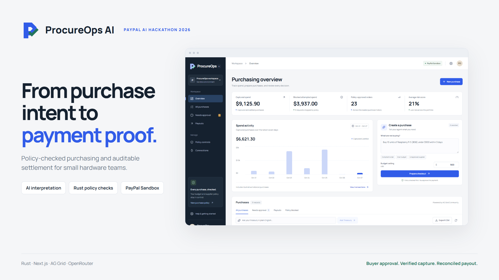

# ProcureOps AI



A procurement assistant and treasury cockpit for the PayPal AI Hackathon 2026. Rust (Axum/Tokio) validates purchasing policy, Next.js displays the workflow, and AG Grid Community provides the ledger.

Small hardware teams can describe a purchase, inspect independently enforced policy, approve a PayPal Sandbox payment, and review its capture and separate payout in one workspace. The [judge guide](docs/JUDGE_GUIDE.md) provides a five-minute tour and connected-test instructions.

## Run locally

Requires Rust and Node.js >=20.9.0. This build was verified with Node 24.12.0. Run the Rust backend. This release contains the supported Rust application.

```powershell
# Terminal 1, from the project directory
if (-not (Test-Path backend/.env)) { Copy-Item backend/.env.example backend/.env }
cd backend
cargo run --locked
```

```powershell
# Terminal 2, from the project directory
cd frontend
if (-not (Test-Path .env.local)) { Copy-Item .env.example .env.local }
npm ci
npm run dev
```

Open http://localhost:3000. The default is explicitly labeled **simulation** and moves no money. The 25 historical rows and supplier catalog are illustrative data. New simulation rows carry `SIM-` PayPal IDs. Historical seed records cannot trigger payments.

## PayPal Sandbox

Follow [the credential setup guide](docs/PAYPAL_SETUP.md). Set `PAYPAL_MODE=sandbox`, `PAYPAL_CLIENT_ID`, and `PAYPAL_CLIENT_SECRET` in `backend/.env`, then restart the backend. The frontend obtains only the public client ID from `/api/paypal/config`; the secret remains on the server.

1. Execute a mandate. The agent extracts intent, compares available quotes, and validates budget, delivery, supplier quality, and the vendor whitelist.
2. The backend creates an Orders v2 order in `AWAITING_APPROVAL`.
3. Approve using the PayPal JavaScript SDK v6 button and your Sandbox Personal buyer account.
4. The server checks PayPal approval, captures with a stable request ID, verifies the returned reference, amount and currency, and stores the capture ID. Only confirmed captures become `COMPLETED`.
5. An eligible captured order can initiate a separate Sandbox vendor payout. It stays `PAYOUT_PENDING` until the matching recipient item succeeds. Use **Check payout** to reconcile it.

The demo's fund flow is buyer -> ProcureOps Sandbox merchant -> configured owned Sandbox payout receiver. It does not purchase physical products from the catalog companies. `PAYPAL_PAYOUT_RECEIVER_EMAIL` is an owned test account; illustrative supplier emails are never used for real API payouts.

Real API errors remain errors. Timeouts remain unresolved until reconciled. Simulation is a separate mode, never an automatic successful substitute for a failed PayPal request. Production PayPal endpoints are intentionally unsupported.

Actual Sandbox verification passed on 2026-10-27: buyer approval, a completed 78.50 USD capture, and a successful payout confirmed in the owned recipient account. See [the Sandbox verification report](docs/SANDBOX_VERIFICATION.md). An earlier review-held test remains pending and is recorded separately.

## AI and guardrails

Follow [OpenRouter setup](docs/AI_SETUP.md): set server-side `LLM_PROVIDER=openrouter`, `OPENROUTER_API_KEY` and `LLM_MODEL=openrouter/free` for model-based intent extraction and typed analytics translation. Direct OpenAI remains supported as an alternative. Without a key, a deterministic parser is available. The UI identifies the actual returned provider/model, `deterministic`, or `deterministic_fallback` per operation. Actual OpenRouter mandate and treasury-query inference passed on 2026-10-27; see [model verification](docs/AI_VERIFICATION.md).

`ApprovedMandate` has private Rust fields and the order creation method requires that type. This forces the order path through deterministic runtime validation. It is a type-system boundary, not cryptographic payment authorization. Analytics runs a closed predicate AST rather than generated executable code.

## Verification

```powershell
cd backend
cargo check --locked
cargo test --locked
cargo build --locked
```

```powershell
cd frontend
npm run lint
npm run build
npm run verify:browser
```

The browser verifier requires installed Google Chrome, ports 8000 and 13000 available, and a freshly built Rust binary. It launches temporary servers, writes only an isolated ledger under `.verification/`, and stops the servers afterward. Provider HTTP fixtures and the browser SDK contract test do not establish that your real PayPal account is connected. The SDK contract test intercepts the SDK script deliberately.

The frontend uses the supported webpack path and official Tailwind PostCSS integration to avoid the observed Windows Turbopack subprocess failure. Manrope is hosted locally with its OFL license, so the build does not fetch fonts. The redesigned workspace includes a full-width desktop ledger and phone purchase cards; see [UI verification](docs/UI_REDESIGN.md).

## Documentation and API

- [All hackathon resources and applicability](docs/RESOURCE_INTEGRATION_MATRIX.md)
- [PayPal setup and manual acceptance checks](docs/PAYPAL_SETUP.md)
- [OpenRouter setup and model verification](docs/AI_SETUP.md)
- [Actual OpenRouter verification evidence](docs/AI_VERIFICATION.md)
- [Current endpoint contracts](docs/API_SPEC.md)
- [Implementation checklist](docs/TASKS.md)
- [Verification evidence](docs/VERIFICATION.md)
- [Devpost submission draft](docs/SUBMISSION_DRAFT.md)
- [170-second demo script](docs/DEMO_SCRIPT.md)
- [Importable Postman collection](docs/postman/ProcureOps.postman_collection.json)

PayPal webhook processing verifies signatures through PayPal and fetches authoritative payment/payout details before updating the ledger. Set `PAYPAL_WEBHOOK_ID` only after registering your HTTPS endpoint; manual status checks also work locally.

Ledger mutations are serialized in one Rust process and written with a temporary file and atomic replacement. Capture/payout reservations are persisted before money-moving calls; duplicate requests use stable operation IDs. Run one backend process per ledger file. Authentication, multi-tenant authorization, and multi-instance transactional storage must be implemented before public multi-user hosting. The demo reset refuses to erase Sandbox payment records.

## Submission work

Publish this source with its MIT [LICENSE](LICENSE) under your own repository, then add the real URL to Devpost. Supply the project description, English judge instructions, screenshots, and public YouTube demo. External registration, account credentials, publication, and the final video are owner steps; they are not implied by passing local tests.

Legacy Python prototypes are excluded from this release.
